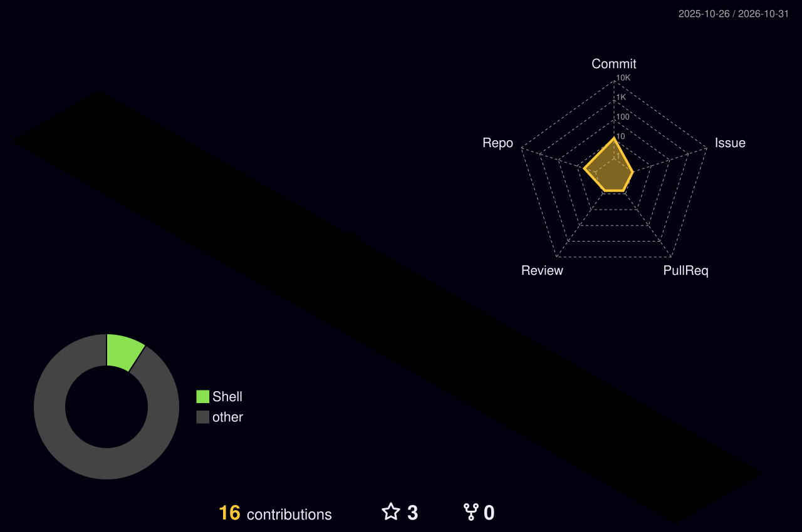
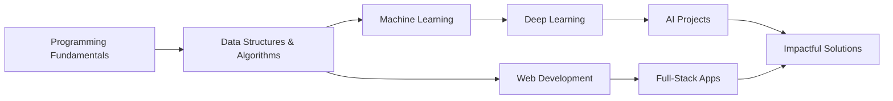

<!-- ===================== HEADER BANNER ===================== -->
<div align="center">


<a href="https://github.com/KappU28">
  
</a>

<br/>


</div>

---

## 👨‍💻 About Me

```python
class Kapindra:
    def __init__(self):
        self.name       = "Kapindra Upreti"
        self.role       = "AI/ML Enthusiast & Software Developer"
        self.education  = "B.E. Computer Engineering @ Acme Engineering College, Nepal"
        self.location   = "Nepal 🇳🇵"
        self.interests  = ["Artificial Intelligence", "Machine Learning",
                           "Software Development", "Problem Solving"]
        self.currently  = "Building projects & exploring emerging technologies"

    def mission(self):
        return "Turning creative ideas into impactful digital experiences."
```

Hey, I'm **Kapindra Upreti**, an undergraduate Computer Engineering student at **Acme Engineering College, Nepal**. I'm passionate about **Artificial Intelligence and Machine Learning**, **software development**, and **problem-solving**. I enjoy building innovative software solutions, exploring emerging technologies, and turning creative ideas into impactful digital experiences.

- 🔭 Currently exploring **AI/ML** and building **software projects**
- 🌱 Learning: Deep Learning, Data Structures & Algorithms, Full-Stack Development
- 🤝 Open to collaborating on **AI/ML**, **open-source**, and **web** projects
- 💬 Ask me about: Python, Machine Learning, Software Development
- ⚡ Fun fact: I love turning a messy problem into clean, working code

---

## 🛠️ Tech Stack

### Languages
<p>
  
</p>

### AI / ML & Data
<p>
  
</p>

### Web & Backend
<p>
  
</p>

### Databases
<p>
  
</p>

### Tools & Platforms
<p>
  
</p>

> 💡 *Edit the icon lists above to match exactly what you use. Full icon list: [skillicons.dev](https://skillicons.dev)*

---
## 📈 GitHub Activity Graph

<div align="center">
  
</div>

---

## 📊 GitHub Stats

<div align="center">


<br/>


</div>

---

## 🏆 Trophies

<div align="center">
  
</div>

---

## 🧊 3D Contribution Calendar

<div align="center">
  
</div>

---

## 🔍 Profile Insights

<div align="center">
  
</div>

<details open>
<summary><b>🗓️ Isometric contributions calendar</b></summary>
<br/>
<div align="center">
  
</div>
</details>

<details>
<summary><b>💡 Recent coding habits</b></summary>
<br/>
<div align="center">
  
</div>
</details>

<details>
<summary><b>🔤 Most used languages</b></summary>
<br/>
<div align="center">
  
</div>
</details>

<details>
<summary><b>⭐ Starred topics</b></summary>
<br/>
<div align="center">
  
</div>
</details>

<details>
<summary><b>📅 Contributions calendar by year</b></summary>
<br/>
<div align="center">
  
</div>
</details>

---

<div align="center">
  <picture>
    <source media="(prefers-color-scheme: dark)" srcset="https://raw.githubusercontent.com/KappU28/KappU28/output/github-contribution-grid-snake-dark.svg"/>
    <source media="(prefers-color-scheme: light)" srcset="https://raw.githubusercontent.com/KappU28/KappU28/output/github-contribution-grid-snake.svg"/>
    
  </picture>
</div>

---


## 🚀 Featured Projects

<!-- Replace the placeholders below with your real repositories -->

| Project | Description | Tech |
|---------|-------------|------|
| 🔹 **[Project One](https://github.com/KappU28/your-repo-1)** | A short description of what it does and why it matters. | `Python` `TensorFlow` |
| 🔹 **[Project Two](https://github.com/KappU28/your-repo-2)** | A short description of what it does and why it matters. | `React` `Node.js` |
| 🔹 **[Project Three](https://github.com/KappU28/your-repo-3)** | A short description of what it does and why it matters. | `Java` `MySQL` |

**Pinned repositories**

<div align="center">

<a href="https://github.com/KappU28/your-repo-1">
  
</a>
<a href="https://github.com/KappU28/your-repo-2">
  
</a>

</div>

---
<!--
## 🎓 Certifications

Uncomment and fill in ONLY certificates you have earned.

<table>
<tr>
<td align="center" width="33%"><br/><sub>Issuer · Year</sub></td>
<td align="center" width="33%"><br/><sub>Issuer · Year</sub></td>
<td align="center" width="33%"><br/><sub>Issuer · Year</sub></td>
</tr>
</table>

---
-->

## 🎯 Currently Working On

- [ ] 🤖 Building and training ML models on real-world datasets
- [ ] 🌐 Developing full-stack applications
- [ ] 🧩 Sharpening problem-solving skills (DSA)
- [ ] 📚 Learning Deep Learning & Neural Networks

---

## 🌱 Learning Roadmap



---

## 📫 Let's Connect

<div align="center">

<a href="https://www.linkedin.com/in/kapindraupreti">
  
</a>
<a href="mailto:upretikapindra28@gmail.com">
  
</a>
<a href="https://github.com/KappU28">
  
</a>

</div>

---

## 💬 Quote of the Day

<div align="center">
  
</div>

---

<div align="center">

### Thanks for visiting ❤️


</div>

